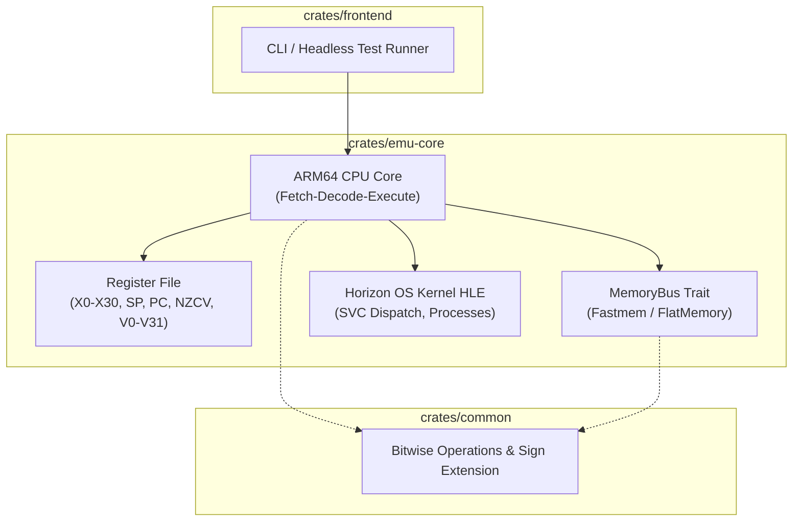

# Mockra Kagami

An experimental, modular AArch64 and Horizon OS console emulator written in **Rust** from the ground up, produced by **Starvald Labs**, with a primary focus on clean architectural separation, accuracy, and test-driven systems engineering.

**Repository**: [https://github.com/sugan-prime/mockra-kagami](https://github.com/sugan-prime/mockra-kagami)

---

## 🏛️ Architecture Overview

The project is structured as a decoupled Cargo workspace where CPU, Memory, OS Kernel, and Frontend concerns are strictly isolated behind clear interfaces and traits:



### Decoupled Subsystems

| Crate | Responsibility |
| :--- | :--- |
| **`crates/common`** | Zero-cost bitwise manipulations, bit range extraction (`[msb:lsb]`), sign extension, and shared primitives. |
| **`crates/emu-core`** | The core emulation engine: AArch64 register file (`X0`–`X30`, `SP`, `PC`, `PSTATE`), instruction decoding, execution loop, memory bus abstractions, and Horizon OS kernel HLE. |
| **`crates/frontend`** | CLI / test runner binary for executing test ROMs, debugging register dumps, and stepping instructions headlessly. |

---

## ⚡ Current Capabilities (Milestones 0 - 11)

- [x] **AArch64 Register File (`registers.rs`)**:
  - 31 General Purpose 64-bit registers (`X0`–`X30`).
  - Architecture-accurate Register 31 dual-role handling: reads as zero (`XZR`/`WZR`) in register context, or acts as Stack Pointer (`SP`) where architecturally specified.
  - Zero-extension guarantees: 32-bit `W` writes unconditionally clear upper 32 bits of 64-bit `X` registers.
  - Full `PSTATE` flags (`NZCV`: Negative, Zero, Carry, Overflow).
  - SIMD/NEON vector register scaffolding (`V0`–`V31`, 128-bit) and `TPIDR_EL0` Thread Local Storage register.
- [x] **Memory & Interconnect Subsystem (`bus.rs`, `system_bus.rs`, `mmio.rs`)**:
  - `MemoryBus` trait decoupled from CPU execution.
  - Endian-safe little-endian integer reads and writes (8-bit, 16-bit, 32-bit, 64-bit).
  - Out-of-bounds safety checks.
  - Modular `SystemBus` routing DRAM memory regions and MMIO peripherals.
  - `DebugUart` mapped at `0xD000_0000` with live guest stdout streaming.
- [x] **AArch64 CPU Core & Opcode Dispatch (`cpu.rs`)**:
  - **Move Wide (Immediate)**: `MOVZ`, `MOVN`, `MOVK` (32-bit & 64-bit).
  - **Arithmetic (Immediate & Register)**: `ADD`, `SUB` (with flag setting and SP operand support).
  - **Branching**: Unconditional Branch (`B`), Branch with Link (`BL`), Return (`RET`), Conditionals (`B.cond` across all 15 condition codes), Compare & Branch (`CBZ`, `CBNZ`).
  - **Address Generation**: `ADR`, `ADRP` (PC-relative 21-bit signed offset address generation).
  - **Memory Load & Store**: `LDR`, `STR`, `LDRSW`, `LDRH`, `STRH`, `LDRB`, `STRB` (unsigned immediate, post/pre-index, and unscaled modes), `LDP`, `STP` register pair operations.
  - **Logicals & Comparisons**: `AND`, `ORR`, `EOR`, `ANDS`/`TST`, `CMP`.
  - **System / OS**: Supervisor Call (`SVC`) trap dispatching.
- [x] **Horizon OS HLE Microkernel & Executable Loader (`loader/nro.rs`, `kernel/svc.rs`)**:
  - **NRO Parser**: Parses `NRO0` header, `.text`, `.rodata`, `.data`, `.bss`, and `MOD0` relative offset.
  - **Dynamic Relocations**: Parses `MOD0` ELF dynamic table (`DT_RELA`, `DT_RELASZ`) and resolves `R_AARCH64_RELATIVE` relocations at load base.
  - **Supervisor Call (SVC) Dispatcher**:
    - `svcCreateThread` (0x08): creates guest threads with entry point, arg, stack, priority, and core affinity.
    - `svcStartThread` (0x09): enqueues guest threads into active core run queues.
    - `svcExitThread` (0x0A): terminates calling guest threads.
    - `svcSleepThread` (0x0B): yields single-threaded interpreter execution.
    - `svcSetThreadCoreMask` (0x0F): sets thread core affinity.
    - `svcArbitrateLock` (0x1A) & `svcArbitrateUnlock` (0x1B): userland futex mutex locking and unlocking.
    - `svcWaitSynchronization` (0x18): waits on single or multiple handles with timeout and auto-reset.
    - `svcSignalEvent` (0x1E) & `svcClearEvent` (0x1F): signals/clears kernel synchronization events and wakes waiting threads.
    - `svcSendSyncRequest` (0x21): dispatches IPC requests to HLE services via TLS command buffer.
    - `svcGetThreadId` (0x25): retrieves active or specified thread ID.
    - `svcOutputDebugString` (0x27): writes guest string buffers to host debug logger.
    - `svcGetInfo` (0x29): returns core mask, physical RAM sizing (4GB), and memory limits.
    - `svcSetHeapSize` (0x35): expands process heap at `0x88000000`.
    - `svcCreateEvent` (0x45): creates connected readable/writable event pairs.
    - `svcExitProcess` (0x07): signals graceful termination to interpreter loop.
  - **In-Memory Codecave / IPSwitch Dynamic Patch Engine (`kernel/patch.rs`)**: Runtime memory overrides with expected-value guards for 60fps patches and bug fixes without altering binaries on disk.
- [x] **Multi-Core Thread Scheduler & Synchronization (`kernel/scheduler.rs`, `kernel/object.rs`)**:
  - 4-core scheduler architecture (Cores 0, 1, 2 for application title execution; Core 3 for Horizon OS kernel services).
  - Priority-based per-core run queues, thread status transitions (`Runnable`, `Waiting`, `Paused`, `Terminated`).
  - Register state preservation and context switching across virtual cores.
  - Fast userland mutex (futex) waiter queues and signal awakening.
- [x] **Game Profile Registry & Title Configuration (`kernel/profile.rs`)**:
  - Pre-populated title database keyed by 64-bit Title ID (`01007EF00011E000` BotW, `0100000000010000` Odyssey, `01006A800016E000` Smash Ultimate, `01006F8002326000` Animal Crossing, `0100152000022000` Mario Kart 8).
  - Configures target FPS, heap sizing, and per-title GPU accuracy profiles.
- [x] **Microkernel Handle Table & Object System (`kernel/handle_table.rs`, `kernel/object.rs`)**:
  - 32-bit handle translation with pseudo-handle resolution (`CURRENT_PROCESS`, `CURRENT_THREAD`).
  - Kernel object abstractions for `KEvent`, `KThread`, `KProcess`, and `KSession`.
- [x] **Horizon IPC & Service Manager (`kernel/ipc/`)**:
  - CMIF Request / Response header parsing and serialization (`SFCI` / `SFCO`).
  - Root Service Manager (`sm:`): `Initialize` (Cmd 0) and `GetService` (Cmd 1).
  - Time Service (`time:`): returns POSIX timestamps and system clock.
  - Human Interface Device (`hid:`): gamepad activation and Npad configuration.
  - GPU Driver Service (`nvdrv:`, `nvdrv:a`): graphics device file descriptors and IOCTL routing.
  - Filesystem Proxy Service (`fsp-srv`, `fsp-pr`): application storage, save data, and RomFS mounting.
- [x] **Tegra X1 Maxwell GPU & 3D Engine (`gpu/maxwell3d.rs`, `gpu/fifo.rs`)**:
  - GPFIFO command processor executing pushbuffer packets across incrementing and non-incrementing modes.
  - Maxwell 3D graphics pipeline: Render target 64-bit address binding, dimension setup, RGBA clear color registers, and hardware surface clearing.
- [x] **NVDRV Driver Interface (`gpu/nvdrv/`)**:
  - `/dev/nvmap` physical/virtual memory allocator (`NVMAP_IOC_CREATE`, `NVMAP_IOC_ALLOC`, `NVMAP_IOC_GET_ID`, `NVMAP_IOC_FREE`).
  - `/dev/nvhost-ctrl` synchronization and hardware syncpoints (`SYNCPT_READ`, `SYNCPT_INCR`, `SYNCPT_WAIT`).
  - `/dev/nvhost-as-gpu` GPU virtual address space allocator (`MAP_BUFFER_EX`, `UNMAP_BUFFER`).
- [x] **GPU Buffer Cache & Coherency Engine (`gpu/buffer_cache.rs`)**:
  - 4KB page-level dirty memory tracking between CPU DRAM and GPU VRAM.
- [x] **Persistent Maxwell Shader Cache (`gpu/shader_cache.rs`)**:
  - 64-bit FNV-1a and MurmurHash3 bytecode hashing across Vertex, Fragment, and Compute pipeline stages.
- [x] **Visual Interface (VI) Display Engine (`gpu/display.rs`)**:
  - Presentation surface supporting Handheld 720p (1280x720) and Docked 1080p (1920x1080) with direct Tegra block-linear frame extraction.
- [x] **Tegra Block-Linear Texture Swizzling Engine (`gpu/texture.rs`)**:
  - Hardware-accurate GOB (Group of Bytes: 64B wide $\times$ 8 lines high) Morton order swizzling and deswizzling.
  - Bit parallel deposit `pdep_u32` implementation for spatial 2D cache locality.
  - Surface swizzling across RGBA8, RGB565, R8, RGBA16F, RGBA32F, and block-compressed textures (BC1, BC2, BC3, BC4, BC5, BC7).
- [x] **Maxwell SASS Shader Recompiler & Decompiler (`gpu/shader/`)**:
  - 64-bit Maxwell instruction decoder (`FFMA`, `FADD`, `FMUL`, `FMNMX`, `FCMP`, `MUFU`, `LDC`, `LDG`, `STG`, `ALD`, `AST`, `TEX`, `BRA`, `KIL`, `EXIT`).
  - Predicate extraction (`PT` unconditional true, conditional branches).
  - Intermediate Representation (NVIR) with automated resource analysis (attributes, uniforms, samplers).
  - Target code emission: Decompiles SASS bytecode directly into standard WebGPU (WGSL) and GLSL shaders.
- [x] **Virtual File System & Package Subsystem (`fs/`)**:
  - **PFS0 / NSP Container Engine (`fs/pfs0.rs`)**: Partition parser and extractor for application packages.
  - **RomFS Asset FileSystem (`fs/romfs.rs`)**: Virtual hierarchical directory tree reader mounting `romfs:/` assets.
  - **Save Data Management (`fs/host.rs`)**: Sandboxed host folder mounting for user save data (`save:/`) and SD card (`sdmc:/`).
  - **Filesystem Proxy Service (`fs/fsp_srv.rs`)**: Full HLE IPC service implementation for `fsp-srv` (`MountRomfs`, `OpenSaveDataFileSystem`, `OpenFile`, `GetSize`, `Read`, `Write`).
- [x] **Audio Subsystem (`audio/`)**:
  - **DSP Audio Mixer (`audio/dsp.rs`)**: Multi-channel voice mixer (up to 256 voices) supporting PCM16, linear interpolation resampling, volume/panning gain matrices, submix buses, and biquad IIR filtering.
  - **Audio Out Service (`audio/audout.rs`)**: Full HLE implementation for `audout:u` and `audout:a` (`ListAudioOuts`, `OpenAudioOut`, `AppendAudioOutBuffer`, `RegisterBufferEvent`, `GetReleasedAudioOutBuffers`, `ContainsAudioOutBuffer`).
  - **Audio Renderer Service (`audio/audren.rs`)**: Modern DSP pipeline for games (`audren:u`, `audren:a`) with `OpenAudioRenderer`, `RequestUpdate` command buffer parsing, voice state management, frame tick synchronization, and `IAudioDevice` volume control.
  - **Audio Diagnostics & Verification**: Stereo 48,000 Hz circular ring buffer, RMS energy and peak amplitude calculations, and automated RIFF/WAVE container file generation.
- [x] **High-Performance JIT Execution & Fastmem (`cpu/jit/`, `memory/fastmem.rs`)**:
  - **Fastmem Software Paging (`memory/fastmem.rs`)**: 4KB paged virtual memory manager providing O(1) page table resolution, page fault handling, RWX permission enforcement, and dirty page tracking for JIT and buffer cache coherency.
  - **Basic Block Intermediate Representation (`cpu/jit/block.rs`)**: Pre-decoded `MicroOp` execution eliminating instruction fetch, decoding, and bit extraction bottlenecks.
  - **AArch64 JIT Block Compiler (`cpu/jit/compiler.rs`)**: Control-flow discovery compiling linear instruction streams up to terminal instructions (`BranchDirect`, `BranchConditional`, `BranchCall`, `BranchRegister`, `CompareAndBranch`, `Svc`, `Fallback`).
  - **Block Cache & Chaining (`cpu/jit/cache.rs`)**: Fast basic block lookup repository with direct branch chaining and range invalidation for self-modifying code.
  - **JitEngine (`cpu/jit/engine.rs`)**: Accelerated block execution engine with seamless, transparent fallback to the pure CPU interpreter for uncompiled opcodes.
- [x] **Commercial Game Readiness, HID Input & Title Packaging (`loader/nca.rs`, `kernel/ipc/`)**:
  - **Nintendo Content Archive Subsystem (`loader/nca.rs`)**: Full NCA3 container parsing, section table resolution, ExeFS / RomFS extraction, and `NcaBuilder`.
  - **HID Controller & Input Subsystem (`kernel/ipc/hid.rs`)**: Full gamepad emulation supporting Pro Controller, Handheld, Joy-Con pairs, dual analog sticks, SixAxis IMU motion sensors, and 200 Hz shared memory ring buffer updates.
  - **System Settings Service (`kernel/ipc/settings.rs`)**: Language code configuration (`en-US`), UI theme colors, and country/region (`USA`).
  - **Applet Manager Services (`kernel/ipc/applet.rs`)**: `appletOE` / `appletAE` application lifecycle proxy, Docked/Handheld operation mode switching, and display layers.
  - **Account Management Services (`kernel/ipc/account.rs`)**: `acc:u0` / `acc:u1` user profile manager and active credentials.
- [x] **Automated Test Suite**:
  - 88 automated unit and integration tests verifying ARM64 ALU, register invariants, bare-metal UART execution, NRO dynamic relocations, event synchronization, IPC services, GPU rendering, block-linear texture swizzling, Maxwell SASS decompilation, the VFS pipeline, audio DSP streaming, JIT execution over Fastmem, commercial game readiness, and multi-core thread scheduling with futex arbitration.

---

## 🚀 Getting Started

### Prerequisites
* **Rust**: `1.85+` (Toolchain: `stable-x86_64-pc-windows-gnu` or `stable-x86_64-pc-windows-msvc`).
* **Cargo**: Included with Rust.

### Building & Running Tests

Run the full automated test suite across all workspace crates:

```bash
cargo test
```

### Running the Emulator

Execute the frontend with an NRO or bare-metal ROM:

```bash
# Run default Horizon OS homebrew NRO:
cargo run --bin frontend

# Or run any custom Nintendo Relocatable Object (.nro):
cargo run --bin frontend -- tests/test_roms/hello_horizon.nro

# Or run a bare-metal ARM64 flat binary (.bin):
cargo run --bin frontend -- tests/test_roms/hello_uart.bin
```

**Horizon OS NRO Execution Output:**
```text
=== Mockra Kagami (Rust AArch64 & Horizon OS HLE Runner) by Starvald Labs ===

Examining target binary: tests/test_roms/hello_horizon.nro
Detected format: Nintendo Relocatable Object (NRO0)
Starting Horizon OS HLE Subsystem...

NRO Executable Loaded:
  Load Base:   0x0000007100000000
  Text:        offset: 0x00000000, size: 0x200
  Rodata:      offset: 0x00000200, size: 0x100
  Data:        offset: 0x00000300, size: 0x100
  BSS Size:    0x1000 bytes

--- [Horizon Guest Execution Output] ---
Hello Horizon OS from NRO!

--- [Horizon Process Exited: svcExitProcess] ---

--- Process Execution Summary ---
  Exit Status:  Process terminated gracefully (svcExitProcess)
  Final PC:     0x00000071000000A0
  Cycle Count:  9
  Alloc Heap:   0x200000 bytes at 0x88000000
```

---

## 🗺️ Project Roadmap

- [x] **Milestone 0: Scaffolding & Foundation**
  - Workspace structure, Register File, MemoryBus trait, ALU basics, SVC trap.
- [x] **Milestone 1: CPU Memory Access & Control Flow**
  - Load/Store single: `LDR`, `STR`, `LDRSW`, `LDRH`, `STRH`, `LDRB`, `STRB` (unsigned immediate, post/pre-index, and unscaled offset).
  - Load/Store pair: `LDP`, `STP` (post-index, pre-index, and signed offset).
  - Conditional branches: `B.cond` (`EQ`, `NE`, `CS/HS`, `CC/LO`, `MI`, `PL`, `VS`, `VC`, `HI`, `LS`, `GE`, `LT`, `GT`, `LE`, `AL`).
  - Compare and branch: `CBZ`, `CBNZ` (32-bit and 64-bit zero/non-zero branch).
  - Register logicals: `AND`, `ORR` (`MOV`), `EOR`, `ANDS` (`TST`).
  - Comparison operations: `CMP` (immediate & register via `SUBS` to `XZR`/`WZR`).
- [x] **Milestone 2: Bare-Metal Test ROM Runner & MMIO UART**
  - Modular `SystemBus` routing accesses to DRAM and peripherals.
  - `MmioDevice` trait and `DebugUart` mapped at `0xD000_0000` for live guest string output.
  - PC-relative addressing (`ADR`, `ADRP`).
  - `load_flat_binary` loader for external `.bin` executable files.
  - Standalone compiled assembly test ROM (`hello_uart.s` -> `hello_uart.bin`) with automated integration tests.
- [x] **Milestone 3: Horizon OS Kernel Foundation & NRO Loader**
  - Parse `.nro` (Nintendo Relocatable Object) headers and segments (`.text`, `.rodata`, `.data`, `.bss`).
  - Parse `MOD0` header and apply ELF dynamic relocations (`R_AARCH64_RELATIVE`).
  - Horizon OS SVC Dispatcher: `svcOutputDebugString` (0x27), `svcSetHeapSize` (0x35), `svcExitProcess` (0x07), `svcSleepThread` (0x0B), `svcGetInfo` (0x29).
  - Dynamic Codecave & In-Memory Patch Engine (IPSwitch / Cemu-style runtime patching).
  - Automated integration test executing an assembled Switch homebrew `.nro`.
- [x] **Milestone 4: Game Profiles & Multithreaded Kernel Objects**
  - Per-TitleId Game Profile Registry (custom memory boundaries, timing quirks, and patch profiles).
  - Microkernel synchronization & thread management (`KProcess`, `KThread`, `KEvent`, `HandleTable`).
  - Horizon OS IPC (Inter-Process Communication via CMIF / HIPC service dispatch: `sm:`, `hid`, `time`).
- [x] **Milestone 5: GPU Subsystem & Graphics Presentation**
  - NVDRV service interface (`nvhost-ctrl`, `nvmap`, `ioctl` handling).
  - Tegra Command FIFO pushbuffer & 3D state machine (`Maxwell3D`).
  - GPU Buffer Cache with 4KB Dirty Memory Page Tracking.
  - Persistent Maxwell shader bytecode cache with FNV-1a & MurmurHash3 hashing.
  - Display engine supporting Handheld 720p / Docked 1080p frame presentation.
- [x] **Milestone 6: Virtual File System & Package Subsystem**
  - PFS0 / NSP partition format parser and extractor.
  - Hierarchical RomFS asset filesystem reader (`romfs:/`).
  - Host directory mounting for user save data (`save:/`) and SD card (`sdmc:/`).
  - `fsp-srv` / `fsp-pr` HLE IPC service implementation.
- [x] **Milestone 7: Audio Subsystem & Hardware DSP**
  - High-performance multi-channel PCM audio mixer (up to 256 voices, biquad IIR filtering, resampling).
  - Horizon OS Audio Out (`audout:u`, `audout:a`) and Audio Renderer (`audren:u`, `audren:a`) HLE services.
  - 48 kHz stereo ring buffer, RMS energy tracking, and WAV file export.
- [x] **Milestone 8: High-Performance Execution & Dynamic Binary Translation (JIT / Fastmem)**
  - 4KB paged virtual memory manager (`Fastmem`) with $O(1)$ page lookups and dirty tracking.
  - Pre-decoded intermediate representation (`MicroOp`) and basic block compilation.
  - Direct branch chaining, cache invalidation, and seamless interpreter fallback (`JitEngine`).
- [x] **Milestone 9: Commercial Game Readiness, HID Input & Title Packaging**
  - Nintendo Content Archive (NCA3) parsing, section tables, and `NcaBuilder`.
  - Comprehensive HID controller emulation (Pro Controller, Joy-Con pairs, dual analogs, SixAxis IMU).
  - 200 Hz shared memory ring buffer for zero-IPC controller polling.
  - Horizon OS system services: `set:sys`, `appletOE`, `appletAE`, and `acc:u0`.
- [x] **Milestone 10: Multi-Core Threading, Kernel Scheduler & Title Orchestration**
  - 4-core Cortex-A57 scheduler (Cores 0-2 Title, Core 3 OS) with priority-based run queues.
  - Architectural thread context switching, register preservation, and thread affinity mask configuration.
  - Horizon OS thread lifecycle SVCs (0x08 `svcCreateThread`, 0x09 `svcStartThread`, 0x0A `svcExitThread`, 0x0F `svcSetThreadCoreMask`, 0x25 `svcGetThreadId`).
  - Fast userland mutex (futex) arbitration: 0x1A `svcArbitrateLock` and 0x1B `svcArbitrateUnlock`.
  - Cross-thread event signaling (`svcSignalEvent`) awakening waiting threads.
- [x] **Milestone 11: Tegra Texture Swizzling Engine & Maxwell/Ampere Shader Decompiler**
  - Hardware-accurate Tegra GOB Morton swizzling and deswizzling with parallel bit deposit (`pdep_u32`).
  - Pixel and block-compressed format swizzling (RGBA8, RGB565, R8, RGBA16F, BC1, BC2, BC3, BC4, BC5, BC7).
  - Direct block-linear VI display surface frame presentation.
  - 64-bit Maxwell SASS instruction decoding and predicate evaluation.
  - Intermediate Representation (NVIR) with automated resource discovery (attributes, uniforms, samplers).
  - WebGPU (WGSL) and GLSL shader code emission.

---

## 📄 License

Licensed under either of:
* Apache License, Version 2.0 ([LICENSE-APACHE](LICENSE-APACHE) or http://www.apache.org/licenses/LICENSE-2.0)
* MIT license ([LICENSE-MIT](LICENSE-MIT) or http://opensource.org/licenses/MIT)

at your option.
