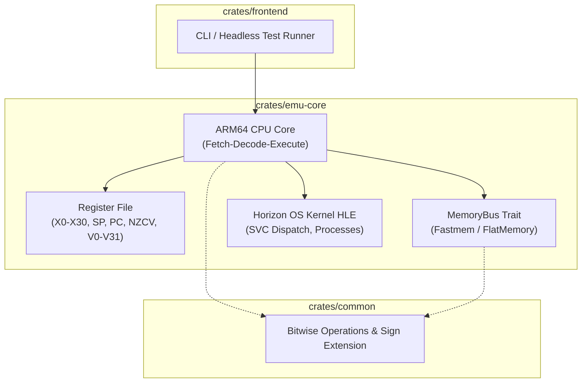

# Switch-Emulator

An experimental, modular Nintendo Switch / Switch 2 emulator written in **Rust** from the ground up, with a primary focus on clean architectural separation, accuracy, and test-driven systems engineering.

---

## 🏛️ Architecture Overview

The project is structured as a decoupled Cargo workspace where CPU, Memory, OS Kernel, and Frontend concerns are strictly isolated behind clear interfaces and traits:



### Decoupled Subsystems

| Crate | Responsibility |
| :--- | :--- |
| **`crates/common`** | Zero-cost bitwise manipulations, bit range extraction (`[msb:lsb]`), sign extension, and shared primitives. |
| **`crates/emu-core`** | The core emulation engine: AArch64 register file (`X0`–`X30`, `SP`, `PC`, `PSTATE`), instruction decoding, execution loop, memory bus abstractions, and Horizon OS kernel HLE. |
| **`crates/frontend`** | CLI / test runner binary for executing test ROMs, debugging register dumps, and stepping instructions headlessly. |

---

## ⚡ Current Capabilities (Milestones 0 - 3)

- [x] **AArch64 Register File (`registers.rs`)**:
  - 31 General Purpose 64-bit registers (`X0`–`X30`).
  - Architecture-accurate Register 31 dual-role handling: reads as zero (`XZR`/`WZR`) in register context, or acts as Stack Pointer (`SP`) where architecturally specified.
  - Zero-extension guarantees: 32-bit `W` writes unconditionally clear upper 32 bits of 64-bit `X` registers.
  - Full `PSTATE` flags (`NZCV`: Negative, Zero, Carry, Overflow).
  - SIMD/NEON vector register scaffolding (`V0`–`V31`, 128-bit).
- [x] **Memory & Interconnect Subsystem (`bus.rs`, `system_bus.rs`, `mmio.rs`)**:
  - `MemoryBus` trait decoupled from CPU execution.
  - Endian-safe little-endian integer reads and writes (8-bit, 16-bit, 32-bit, 64-bit).
  - Out-of-bounds safety checks.
  - Modular `SystemBus` routing DRAM memory regions and MMIO peripherals.
  - `DebugUart` mapped at `0xD000_0000` with live guest stdout streaming.
- [x] **AArch64 CPU Core & Opcode Dispatch (`cpu.rs`)**:
  - **Move Wide (Immediate)**: `MOVZ`, `MOVN`, `MOVK` (32-bit & 64-bit).
  - **Arithmetic (Immediate & Register)**: `ADD`, `SUB` (with flag setting and SP operand support).
  - **Branching**: Unconditional Branch (`B`), Branch with Link (`BL`), Return (`RET`), Conditionals (`B.cond` across all 15 condition codes), Compare & Branch (`CBZ`, `CBNZ`).
  - **Address Generation**: `ADR`, `ADRP` (PC-relative 21-bit signed offset address generation).
  - **Memory Load & Store**: `LDR`, `STR`, `LDRSW`, `LDRH`, `STRH`, `LDRB`, `STRB` (unsigned immediate, post/pre-index, and unscaled modes), `LDP`, `STP` register pair operations.
  - **Logicals & Comparisons**: `AND`, `ORR`, `EOR`, `ANDS`/`TST`, `CMP`.
  - **System / OS**: Supervisor Call (`SVC`) trap dispatching.
- [x] **Horizon OS HLE Microkernel & Executable Loader (`loader/nro.rs`, `kernel/svc.rs`)**:
  - **NRO Parser**: Parses `NRO0` header, `.text`, `.rodata`, `.data`, `.bss`, and `MOD0` relative offset.
  - **Dynamic Relocations**: Parses `MOD0` ELF dynamic table (`DT_RELA`, `DT_RELASZ`) and resolves `R_AARCH64_RELATIVE` relocations at load base.
  - **Supervisor Call (SVC) Dispatcher**:
    - `svcOutputDebugString` (0x27)
    - `svcSetHeapSize` (0x35)
    - `svcExitProcess` (0x07)
    - `svcSleepThread` (0x0B)
    - `svcGetInfo` (0x29)
  - **In-Memory Codecave / IPSwitch Dynamic Patch Engine (`kernel/patch.rs`)**: Runtime memory overrides with expected-value guards for 60fps patches and bug fixes without altering binaries on disk.
- [x] **Automated Test Suite**:
  - 24 automated unit and integration tests verifying ARM64 ALU, register invariants, bare-metal UART execution, NRO dynamic relocations, and Horizon OS SVC syscalls.

---

## 🚀 Getting Started

### Prerequisites
* **Rust**: `1.85+` (Toolchain: `stable-x86_64-pc-windows-gnu` or `stable-x86_64-pc-windows-msvc`).
* **Cargo**: Included with Rust.

### Building & Running Tests

Run the full automated test suite across all workspace crates:

```bash
cargo test
```

### Running the Emulator

Execute the frontend with an NRO or bare-metal ROM:

```bash
# Run default Horizon OS homebrew NRO:
cargo run --bin frontend

# Or run any custom Nintendo Relocatable Object (.nro):
cargo run --bin frontend -- tests/test_roms/hello_horizon.nro

# Or run a bare-metal ARM64 flat binary (.bin):
cargo run --bin frontend -- tests/test_roms/hello_uart.bin
```

**Horizon OS NRO Execution Output:**
```text
=== Switch-Emulator (Rust AArch64 & Horizon OS HLE Runner) ===

Examining target binary: tests/test_roms/hello_horizon.nro
Detected format: Nintendo Relocatable Object (NRO0)
Starting Horizon OS HLE Subsystem...

NRO Executable Loaded:
  Load Base:   0x0000007100000000
  Text:        offset: 0x00000000, size: 0x200
  Rodata:      offset: 0x00000200, size: 0x100
  Data:        offset: 0x00000300, size: 0x100
  BSS Size:    0x1000 bytes

--- [Horizon Guest Execution Output] ---
Hello Horizon OS from NRO!

--- [Horizon Process Exited: svcExitProcess] ---

--- Process Execution Summary ---
  Exit Status:  Process terminated gracefully (svcExitProcess)
  Final PC:     0x00000071000000A0
  Cycle Count:  9
  Alloc Heap:   0x200000 bytes at 0x88000000
```

---

## 🗺️ Project Roadmap

- [x] **Milestone 0: Scaffolding & Foundation**
  - Workspace structure, Register File, MemoryBus trait, ALU basics, SVC trap.
- [x] **Milestone 1: CPU Memory Access & Control Flow**
  - Load/Store single: `LDR`, `STR`, `LDRSW`, `LDRH`, `STRH`, `LDRB`, `STRB` (unsigned immediate, post/pre-index, and unscaled offset).
  - Load/Store pair: `LDP`, `STP` (post-index, pre-index, and signed offset).
  - Conditional branches: `B.cond` (`EQ`, `NE`, `CS/HS`, `CC/LO`, `MI`, `PL`, `VS`, `VC`, `HI`, `LS`, `GE`, `LT`, `GT`, `LE`, `AL`).
  - Compare and branch: `CBZ`, `CBNZ` (32-bit and 64-bit zero/non-zero branch).
  - Register logicals: `AND`, `ORR` (`MOV`), `EOR`, `ANDS` (`TST`).
  - Comparison operations: `CMP` (immediate & register via `SUBS` to `XZR`/`WZR`).
- [x] **Milestone 2: Bare-Metal Test ROM Runner & MMIO UART**
  - Modular `SystemBus` routing accesses to DRAM and peripherals.
  - `MmioDevice` trait and `DebugUart` mapped at `0xD000_0000` for live guest string output.
  - PC-relative addressing (`ADR`, `ADRP`).
  - `load_flat_binary` loader for external `.bin` executable files.
  - Standalone compiled assembly test ROM (`hello_uart.s` -> `hello_uart.bin`) with automated integration tests.
- [x] **Milestone 3: Horizon OS Kernel Foundation & NRO Loader**
  - Parse `.nro` (Nintendo Relocatable Object) headers and segments (`.text`, `.rodata`, `.data`, `.bss`).
  - Parse `MOD0` header and apply ELF dynamic relocations (`R_AARCH64_RELATIVE`).
  - Horizon OS SVC Dispatcher: `svcOutputDebugString` (0x27), `svcSetHeapSize` (0x35), `svcExitProcess` (0x07), `svcSleepThread` (0x0B), `svcGetInfo` (0x29).
  - Dynamic Codecave & In-Memory Patch Engine (IPSwitch / Cemu-style runtime patching).
  - Automated integration test executing an assembled Switch homebrew `.nro`.
- [ ] **Milestone 4: Game Profiles & Multithreaded Kernel Objects**
  - Per-TitleId Game Profile Registry (custom memory boundaries, timing quirks, and patch profiles).
  - Microkernel synchronization & thread management (`KProcess`, `KThread`, `KEvent`, `KMutex`).
  - Horizon OS IPC (Inter-Process Communication via CMIF / HIPC service dispatch: `sm:`, `fsp-srv`, `hid`, `time`).
- [ ] **Milestone 5: GPU Subsystem & Graphics Presentation**
  - NVDRV service interface (`nvhost-ctrl`, `nvmap`, `ioctl` handling).
  - Tegra Command FIFO pushbuffer & 3D state machine.
  - GPU Buffer Cache with Dirty Memory Page Tracking (guard-page write interception).
  - Shader Transpiler foundation & persistent disk shader cache (bytecode hashing).
  - SDL3 / Vulkan window presentation.

---

## 📄 License

Licensed under either of:
* Apache License, Version 2.0 ([LICENSE-APACHE](LICENSE-APACHE) or http://www.apache.org/licenses/LICENSE-2.0)
* MIT license ([LICENSE-MIT](LICENSE-MIT) or http://opensource.org/licenses/MIT)

at your option.
