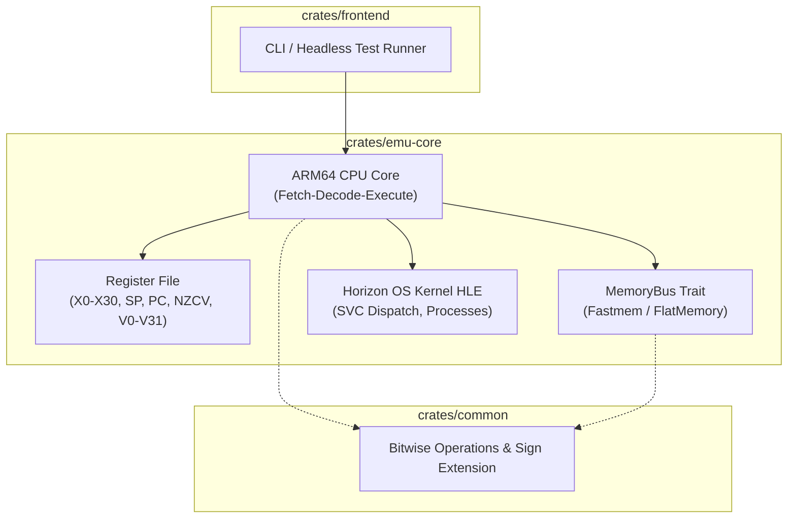

# Switch-Emulator

An experimental, modular Nintendo Switch / Switch 2 emulator written in **Rust** from the ground up, with a primary focus on clean architectural separation, accuracy, and test-driven systems engineering.

---

## 🏛️ Architecture Overview

The project is structured as a decoupled Cargo workspace where CPU, Memory, OS Kernel, and Frontend concerns are strictly isolated behind clear interfaces and traits:



### Decoupled Subsystems

| Crate | Responsibility |
| :--- | :--- |
| **`crates/common`** | Zero-cost bitwise manipulations, bit range extraction (`[msb:lsb]`), sign extension, and shared primitives. |
| **`crates/emu-core`** | The core emulation engine: AArch64 register file (`X0`–`X30`, `SP`, `PC`, `PSTATE`), instruction decoding, execution loop, memory bus abstractions, and Horizon OS kernel HLE. |
| **`crates/frontend`** | CLI / test runner binary for executing test ROMs, debugging register dumps, and stepping instructions headlessly. |

---

## ⚡ Current Capabilities (Milestone 0)

- [x] **AArch64 Register File (`registers.rs`)**:
  - 31 General Purpose 64-bit registers (`X0`–`X30`).
  - Architecture-accurate Register 31 dual-role handling: reads as zero (`XZR`/`WZR`) in register context, or acts as Stack Pointer (`SP`) where architecturally specified.
  - Zero-extension guarantees: 32-bit `W` writes unconditionally clear upper 32 bits of 64-bit `X` registers.
  - Full `PSTATE` flags (`NZCV`: Negative, Zero, Carry, Overflow).
  - SIMD/NEON vector register scaffolding (`V0`–`V31`, 128-bit).
- [x] **Memory Bus Abstraction (`bus.rs`)**:
  - `MemoryBus` trait decoupled from CPU execution.
  - Endian-safe little-endian integer reads and writes (8-bit, 16-bit, 32-bit, 64-bit).
  - Out-of-bounds safety checks.
- [x] **Core Fetch-Decode-Execute Engine (`cpu.rs`)**:
  - Monotonic cycle counting.
  - Foundational instruction decoding:
    - **Move Wide (Immediate)**: `MOVZ`, `MOVN`, `MOVK` (32-bit & 64-bit).
    - **Arithmetic (Immediate & Register)**: `ADD`, `SUB` (with optional flag setting and SP operand support).
    - **Branching**: Unconditional Branch (`B`), Branch with Link (`BL`), Return (`RET`).
    - **System / OS**: Supervisor Call (`SVC`) trap dispatching.
- [x] **Automated Unit Test Suite**:
  - 100% passing test coverage across bit operations, register invariants, and ALU execution.

---

## 🚀 Getting Started

### Prerequisites
* **Rust**: `1.85+` (Toolchain: `stable-x86_64-pc-windows-gnu` or `stable-x86_64-pc-windows-msvc`).
* **Cargo**: Included with Rust.

### Building & Running Tests

Run the full automated test suite across all workspace crates:

```bash
cargo test
```

### Running the Test Runner

Execute the headless test runner to run the built-in bare-metal test binary:

```bash
cargo run --bin frontend
```

**Sample Output:**
```text
=== Switch-Emulator (Rust AArch64 Core Prototype) ===
Starting execution at PC: 0x0000000080000000...

[Step 0001] Executed at 0x80000000
[Step 0002] Executed at 0x80000004
[Step 0003] Executed at 0x80000008

[TRAP] Supervisor Call (SVC 0x0042) invoked at PC: 0x8000000C

--- Register Dump ---
  X0: 0x0000000000000064 (100)
  X1: 0x000000000000015E (250)
  X2: 0x00000000000001C2 (350)
  X3: 0x0000000000000000 (0)
  SP: 0x0000000000000000
  PC: 0x0000000080000010
  Cycles: 4
```

---

## 🗺️ Project Roadmap

- [x] **Milestone 0: Scaffolding & Foundation**
  - Workspace structure, Register File, MemoryBus trait, ALU basics, SVC trap.
- [ ] **Milestone 1: CPU Memory Access & Control Flow**
  - Load/Store instructions: `LDR`, `STR` (unsigned offset, post/pre-indexed).
  - Conditional branches: `B.cond` (`EQ`, `NE`, `LT`, `GE`, `GT`, `LE`).
  - Flag-setting comparisons (`CMP`, `CMN`, `TST`).
- [ ] **Milestone 2: Bare-Metal Test ROM Runner**
  - Load flat `.bin` binaries into virtual memory.
  - Memory-mapped I/O (MMIO) UART output port for guest logging.
- [ ] **Milestone 3: Horizon OS Microkernel & NRO Loader**
  - Parse `.nro` (Nintendo Relocatable Object) and `MOD0` relocation tables.
  - Implement essential Horizon SVCs: `svcOutputDebugString`, `svcSetHeapSize`, `svcExitProcess`.
  - Boot minimal `libnx` "Hello World" homebrew.
- [ ] **Milestone 4: GPU Display & Graphics Frontend**
  - Linear 1280x720 32bpp RGBA framebuffer mapping.
  - SDL3 / Raylib window display.

---

## 📄 License

Licensed under either of:
* Apache License, Version 2.0 ([LICENSE-APACHE](LICENSE-APACHE) or http://www.apache.org/licenses/LICENSE-2.0)
* MIT license ([LICENSE-MIT](LICENSE-MIT) or http://opensource.org/licenses/MIT)

at your option.
